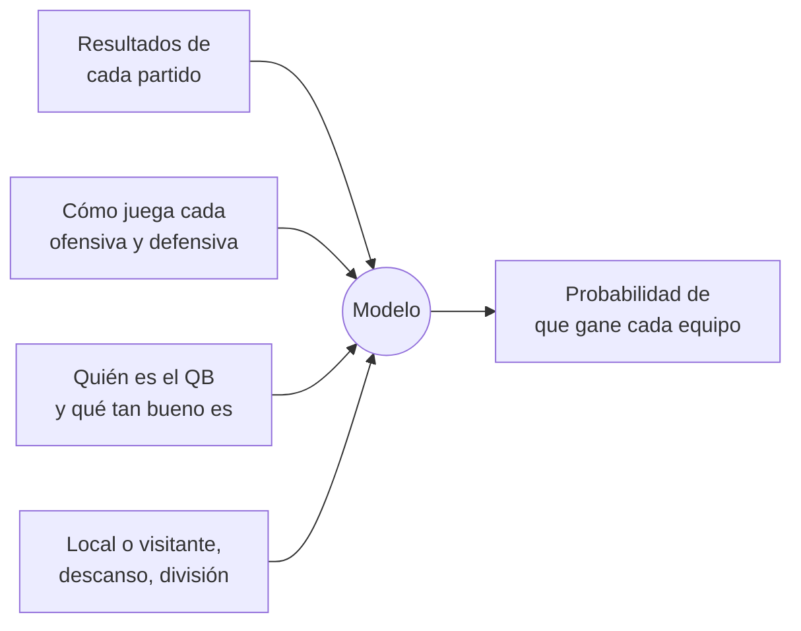
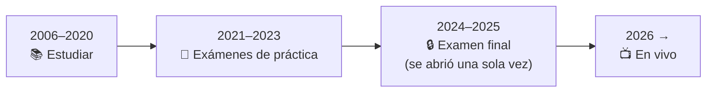
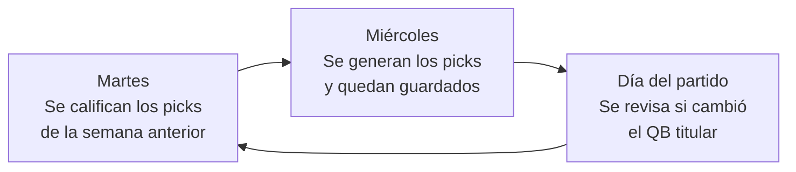

# ¿De dónde salen los porcentajes? Así funciona el modelo

> Para quien ve los picks en redes y quiere entender qué hay detrás.
> Versión técnica: [tecnica.md](tecnica.md).
>
> **Esto es un experimento de ciencia de datos. No es consejo de apuestas.**

## En 30 segundos

- Cada semana, una computadora calcula **qué tan probable es que gane cada equipo** en cada partido de la NFL.
- Aprendió de **casi 20 años de partidos** (desde 2006): quién ganó, cómo jugó cada ofensiva y defensiva, y qué tan bueno es cada quarterback.
- Compara su número con el de **Las Vegas**, que es la referencia más difícil de vencer.
- Cada pick queda **guardado antes del partido** y no se puede cambiar. Así el historial es honesto.
- Su punto fuerte: **cuando dice 75%, acierta cerca del 75% de las veces.** No le gana a Las Vegas, y no promete hacerlo.

---

## 1. ¿Qué significa "BUF 80%"?

Que, según el modelo, si ese mismo partido se jugara 10 veces, Buffalo ganaría unas 8.

**No significa que BUF vaya a ganar seguro.** Significa que de cada 10 picks de 80%, se espera fallar unos 2. Si un pick de 80% falla, no es que el modelo "se equivocó": es justo lo que el 80% avisaba que podía pasar.

Por eso el historial se muestra **por rangos de confianza**:

| Cuando el modelo dice… | Debería acertar… |
|---|---|
| 50–60% | poco más de la mitad (casi una moneda al aire) |
| 60–70% | unas 6 de cada 10 |
| 70–80% | unas 7 de cada 10 |
| 80% o más | unas 8 de cada 10 |

Un modelo es bueno si **esos números se cumplen**. A eso se le llama estar "calibrado".

## 2. ¿Qué mira el modelo?

### El ranking de fuerza (tipo ajedrez)

Cada equipo tiene una calificación de fuerza, como en el ajedrez. Ganar le sube puntos y perder le baja. **Ganarle a un equipo fuerte da más puntos que ganarle a uno débil.** Al empezar cada temporada, todos se acercan un poco al promedio, porque los equipos cambian en el receso.

Es la pieza que más pesa en el modelo.

### Qué tan bien juega cada equipo, jugada por jugada

No basta con saber quién ganó: un equipo puede ganar con suerte. Por eso el modelo mide **cada jugada**: ¿esa jugada acercó al equipo a anotar o lo alejó? Esto se mide por separado para:

- el **ataque por aire** y el **ataque por tierra**,
- lo que **permite la defensa** por aire y por tierra.

Los últimos partidos pesan más que los viejos: un partido de hace un mes pesa más o menos la mitad que el de la semana pasada.

### El quarterback

El QB es la posición más importante del fútbol americano, así que el modelo le da su propia calificación según cómo ha jugado en sus pases.

- Si un QB **ha jugado poco** (un novato o un suplente), el modelo es prudente: lo trata como un poco peor que el promedio hasta tener más información.
- Si **entra el suplente** en lugar del titular, el modelo lo nota y ajusta la probabilidad.

Agregar al quarterback fue **la mejora más grande** después del ranking de fuerza.

### Detalles del partido

- **Ser local** da ventaja (en la NFL el local gana ~55% de las veces).
- **Partidos de la misma división** suelen ser más parejos.
- **Días de descanso** y si un equipo viene de su semana libre.

Estos detalles ayudan poco, pero algo.

### Lo que el modelo NO mira

- Lesiones (salvo quién es el QB titular).
- Clima.
- Noticias, vestidores, motivación.
- **La línea de Las Vegas.** A propósito: si la usara, dejaría de tener opinión propia y solo copiaría al mercado.

## 3. ¿Por qué comparar con Las Vegas?

Las casas de apuestas tienen equipos enteros, información de lesiones al minuto y millones de dólares en juego. Su línea final es **la predicción más precisa que existe públicamente**. Si un modelo se acerca a Las Vegas, está haciendo un buen trabajo.

Cuando ves "Modelo 72% · Las Vegas 80%", significa que ambos van con el mismo equipo, pero Las Vegas tiene más confianza.

## 4. ¿Cómo sabemos que funciona? (sin hacer trampa)

El error más común al hacer modelos es **probarlos con datos que ya conocen**: es como hacer un examen con las respuestas en la mano. Aquí se hizo distinto:

1. **Estudiar (2006–2020):** el modelo aprende con esos partidos.
2. **Exámenes de práctica (2021–2023):** se prueban varias versiones y se elige la mejor.
3. **Examen final (2024–2025):** estas temporadas se guardaron bajo llave y **se abrieron una sola vez**, ya con el modelo terminado. Nada se ajustó después de verlas.
4. **En vivo (2026 en adelante):** los picks reales de cada semana.

Además, en el examen final el modelo predijo **semana por semana**, usando solo lo que se sabía antes de cada partido, igual que en la vida real.

## 5. Los resultados

### Examen final: temporadas 2024 y 2025 (569 partidos)

| Método | Partidos ganadores acertados |
|---|---|
| Elegir siempre al local | 54% |
| Solo el ranking de fuerza | 66% |
| **El modelo** | **64%** |
| Las Vegas | 68% |

### ¿Se cumplen los porcentajes?

| Cuando el modelo dijo… | Partidos | Acertó |
|---|---|---|
| 50–60% | 224 | 53% |
| 60–70% | 165 | 64% |
| 70–80% | 131 | **76%** |
| 80% o más | 49 | **86%** |

**Esto es lo más importante.** Los porcentajes del modelo significan lo que dicen. En los picks de 70% o más acertó **142 de 180 (79%)**.

### La lectura honesta

- En número de ganadores, el modelo quedó **un poco debajo del ranking de fuerza solo**. ¿Entonces para qué sirve? Porque sus **porcentajes son más confiables**: sabe distinguir mejor un 55% de un 80%.
- **No le gana a Las Vegas**, y nunca fue la meta.
- Cuando el modelo y Las Vegas eligieron **distinto ganador** (83 partidos), Las Vegas acertó 53 y el modelo 30. **Si el modelo va contra Las Vegas, lo más probable es que tenga razón Las Vegas.**
- Su punto débil: las **últimas dos semanas de la temporada**, cuando algunos equipos ya clasificados descansan a sus titulares.

## 6. La rutina de cada semana

**Reglas del historial:**

- Los picks se guardan **antes** del primer partido de la semana.
- **Nunca se borran ni se editan**, aunque el modelo cambie de opinión después.
- Los empates no cuentan.
- Si al generar el pick todavía no se anunciaba el QB titular, se asume el de la semana anterior y el pick lleva un asterisco (\*).

## 7. Cómo leer las imágenes

- **Picks fuertes:** los partidos donde el modelo tiene más confianza.
- **Modelo vs. Las Vegas:** el partido donde más se separan las dos opiniones. Es interesante para platicar, **no** es una señal para apostar.
- **Duelo de la semana:** el choque más desigual entre un ataque y la defensa rival (por ejemplo, el mejor ataque terrestre contra una de las peores defensas ante la carrera). Es contexto para entender el partido; **el modelo no usa estos rankings** para calcular el porcentaje.
- **Historial:** aciertos por rango de confianza. Mientras no haya suficientes picks en vivo, muestra el examen final 2024–2025 y lo indica.

## 8. Preguntas frecuentes

**¿Puedo apostar con esto?**
No es la intención. El modelo no le gana a Las Vegas, así que no hay razón para pensar que deje ganancias. Es un experimento para entender el deporte con datos.

**El modelo falló un pick de 80%. ¿Está mal?**
No necesariamente. 80% quiere decir que 2 de cada 10 se fallan. Hay que juzgarlo con muchos partidos, no con uno.

**Lleva una mala racha, ¿ya no sirve?**
Con pocas semanas no se puede concluir nada. Una racha de 10 o 20 partidos es mucha suerte (buena o mala). El historial solo empieza a decir algo con varios cientos de partidos.

**¿Por qué no mejoran el modelo cada semana?**
Porque cambiarlo después de ver los resultados es la forma más fácil de engañarse. Cualquier cambio se decide con reglas fijadas antes y se prueba con los picks en vivo.

**¿Probaron cruzar el ataque de un equipo con la defensa del otro?**
Sí. Se probó si "buen ataque aéreo contra mala defensa de pase" agregaba algo extra. No agregó: el modelo ya considera el ataque de uno y la defensa del otro, y el choque no vale más que la suma de las dos partes.

**¿De dónde salen los datos?**
De nflverse, una fuente pública y gratuita con todos los partidos y cada jugada desde 1999.

## 9. Glosario

| Término | Qué significa aquí |
|---|---|
| **Probabilidad** | Qué tan seguido ganaría un equipo si el partido se repitiera muchas veces |
| **Pick** | El equipo que el modelo cree más probable que gane |
| **Confianza** | El porcentaje del pick (50% = moneda al aire, 90% = muy claro) |
| **Calibrado** | Que los porcentajes se cumplan: los picks de 70% aciertan ~70% |
| **Ranking de fuerza (Elo)** | Calificación de cada equipo que sube al ganar y baja al perder |
| **Las Vegas / línea** | La probabilidad que reflejan las apuestas, sin la comisión de la casa |
| **Examen final / prueba honesta** | Temporadas 2024–2025, guardadas sin ver hasta el final |
| **Local** | El equipo que juega en su estadio |
| **Semana libre (bye)** | Semana en que un equipo no juega y descansa |

---

*Experimento de ciencia de datos. No es consejo de apuestas.*
