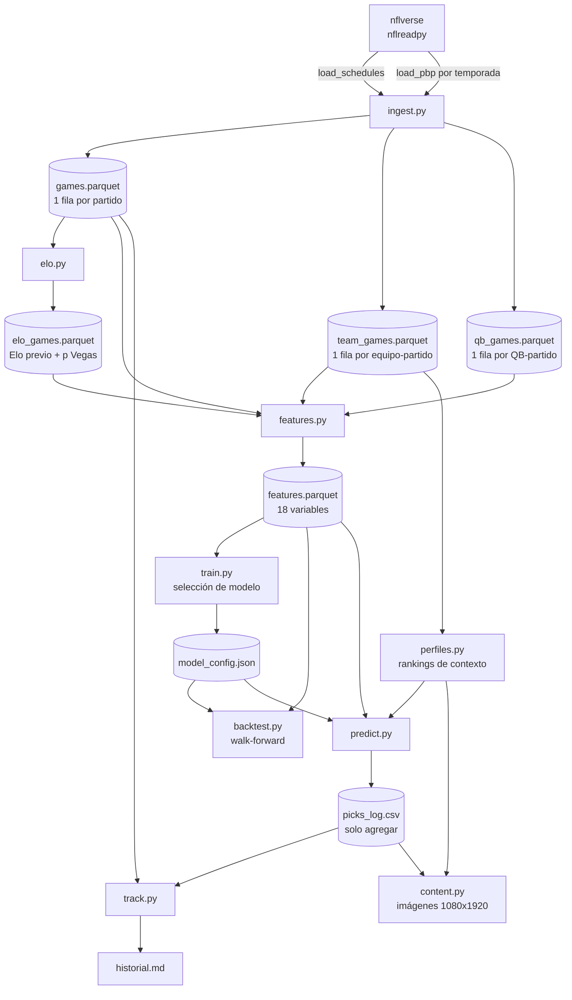
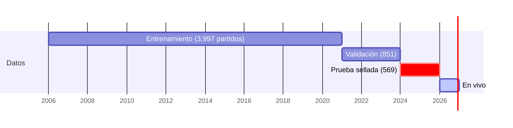
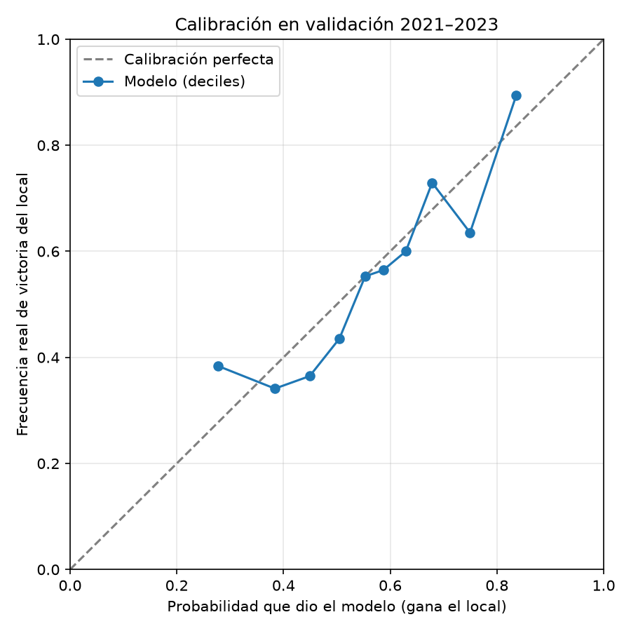
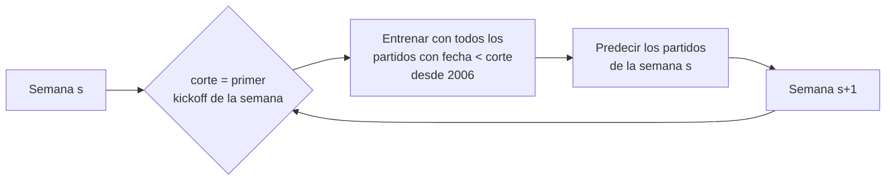
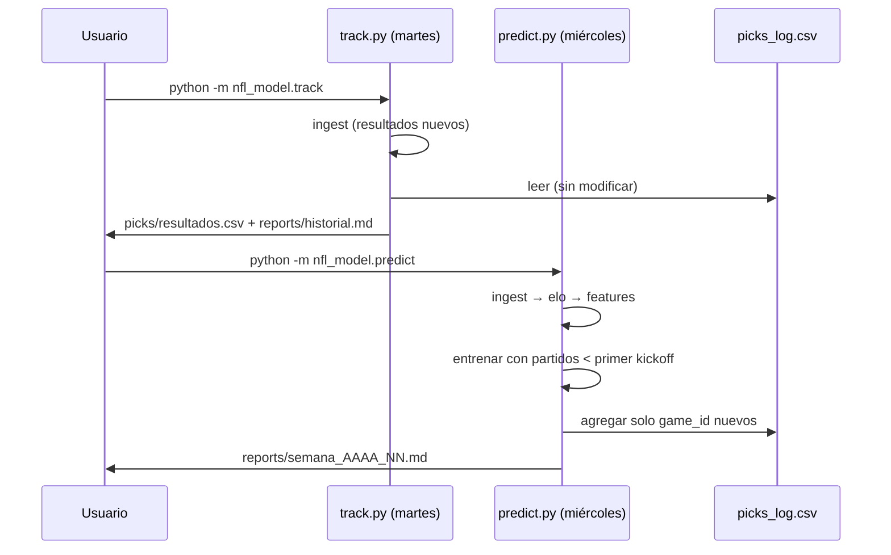

# nfl-model: documentación técnica

> Para lectores con conocimientos de programación, ciencia de datos y machine learning.
> Versión para público general: [general.md](general.md).
>
> Experimento de ciencia de datos. No es consejo de apuestas.

## Índice

1. [Resumen](#1-resumen)
2. [Problema y objetivo](#2-problema-y-objetivo)
3. [Arquitectura y flujo de datos](#3-arquitectura-y-flujo-de-datos)
4. [Datos (Fase 1)](#4-datos-fase-1)
5. [Elo y probabilidad de Las Vegas (Fase 2)](#5-elo-y-probabilidad-de-las-vegas-fase-2)
6. [Variables (Fase 3)](#6-variables-fase-3)
7. [Modelo y calibración (Fase 4)](#7-modelo-y-calibración-fase-4)
8. [Backtest walk-forward (Fase 5)](#8-backtest-walk-forward-fase-5)
9. [Operación semanal (Fase 6)](#9-operación-semanal-fase-6)
10. [Contenido y perfiles de equipo (Fase 7 y extras)](#10-contenido-y-perfiles-de-equipo-fase-7-y-extras)
11. [Experimentos descartados](#11-experimentos-descartados)
12. [Registro de decisiones](#12-registro-de-decisiones)
13. [Limitaciones y riesgos](#13-limitaciones-y-riesgos)
14. [Referencia de módulos, comandos y pruebas](#14-referencia-de-módulos-comandos-y-pruebas)
15. [Trabajo futuro](#15-trabajo-futuro)

---

## 1. Resumen

| Aspecto | Valor |
|---|---|
| Tarea | Clasificación binaria: ¿gana el local? Salida = probabilidad |
| Unidad | Un partido de la NFL |
| Datos | nflverse vía `nflreadpy` (calendario, moneylines, jugada por jugada) |
| Historia usada | Calendario 1999–hoy; entrenamiento desde 2006 |
| Variables | 18, todas calculadas con información previa al kickoff |
| Modelo final | Regresión logística L2, `C = 0.003`, variables estandarizadas, sin recalibración |
| Métrica de selección | Log loss (no accuracy) |
| Validación | Temporal: ajuste 2006–2020, validación 2021–2023, prueba sellada 2024–2025 |
| Benchmark externo | Probabilidad implícita del moneyline de cierre (sin vig) |
| Resultado honesto (2024–2025, 569 partidos) | Acierto 64.3%, log loss 0.6182, Brier 0.2150 |

**Lectura en una línea:** el modelo está bien calibrado y supera al Elo en log loss, pero no a Las Vegas; su valor está en dar probabilidades confiables, no en encontrar ventaja contra el mercado.

## 2. Problema y objetivo

Para cada partido de la semana el sistema produce:

- `p_home_modelo`: probabilidad de que gane el local según el modelo.
- `p_home_vegas`: probabilidad implícita del mercado (moneyline sin comisión).
- El pick (el equipo con p ≥ 0.5) y su confianza `max(p, 1 − p)`.
- Un historial de aciertos por rango de confianza (50–60, 60–70, 70–80, 80+).

**Por qué probabilidad de victoria y no spread:** es más fácil de evaluar (target binario, métricas propias de probabilidades) y de comunicar. Predecir margen queda como mejora futura.

**Definición de "terminado"** (fijada antes de mirar los datos de prueba):

1. En 2024–2025 supera a "siempre gana el local" y al Elo en log loss.
2. Calibración razonable: el rango 70–80% acierta entre 65% y 85%.
3. Un comando genera los picks de la semana y otro califica la anterior.

Superar a Las Vegas de forma sostenida **no** es objetivo. La meta realista era quedar entre Elo (~63–65%) y Las Vegas (~66–67%).

## 3. Arquitectura y flujo de datos



- **Lenguaje y librerías:** Python ≥ 3.10 (desarrollado en 3.14), Polars para el procesamiento, scikit-learn para el modelo, NumPy, Matplotlib para gráficas, pytest.
- **Almacenamiento:** Parquet en `data/` (fuera de git). Lo versionado son el código, los reportes y el registro de picks.
- **Estilo:** cada fase es un módulo ejecutable con `python -m nfl_model.<módulo>` que escribe un reporte Markdown en `reports/`. Los cálculos secuenciales (Elo, forma, QB) se hacen en Python puro sobre listas de dicts en orden cronológico; eso hace explícito qué se sabía en cada momento.

## 4. Datos (Fase 1)

Módulo: [`ingest.py`](../src/nfl_model/ingest.py).

### Fuentes

| Fuente | Función | Uso |
|---|---|---|
| Calendario y resultados | `nfl.load_schedules()` | Partidos, marcadores, descanso, QB titular, moneyline, spread, sede |
| Jugada por jugada | `nfl.load_pbp(temporada)` | EPA, éxito, pase/carrera, QB, yardas, capturas, pérdidas |

Datos públicos, sin llave de API. Las temporadas cerradas se descargan una vez y se guardan; la actual se baja siempre.

### Limpieza

- **Franquicias unificadas** a la abreviatura actual: `OAK→LV`, `SD→LAC`, `STL→LA`, `LAR→LA`, `JAC→JAX`, `WSH→WAS`. Sin esto, el Elo y la forma de un equipo se reiniciarían al mudarse.
- **Sede neutral** marcada (`location == "Neutral"`): ahí la ventaja de local es 0.
- **Target `home_win`:** 1/0 si se jugó y no fue empate; nulo si es empate o no se ha jugado. Los empates (rarísimos) quedan fuera de entrenamiento y evaluación.
- **Jugadas útiles:** solo pases y carreras con EPA no nulo y equipos definidos.
- **QB:** `passer_id` (incluye capturas y scrambles) con `passer_player_id` de respaldo; `qb_epa` con `epa` de respaldo.

### Tablas derivadas

| Tabla | Grano | Columnas clave |
|---|---|---|
| `games.parquet` | partido | `home_win`, `neutral`, `home_rest`, `away_rest`, moneylines, `home_qb_id`, `away_qb_id` |
| `team_games.parquet` | equipo × partido | `off_epa`, `off_pass_epa`, `off_rush_epa`, `off_success`, yardas, capturas, pérdidas y sus `def_*` |
| `qb_games.parquet` | QB × partido | `dropbacks`, `qb_epa_sum` |

La defensiva de un equipo se obtiene como la ofensiva de su rival en ese partido (self-join).

### Hallazgos de calidad

- 7,548 partidos en el calendario; 32 equipos; sin `game_id` duplicados ni marcadores vacíos en juegos jugados.
- Moneyline: ausente 1999–2005, con huecos 2006–2009, completo desde 2010 → **toda comparación con Las Vegas es desde 2010**.
- Faltan jugadas de 3 partidos (1999–2000). Irrelevante: se entrena desde 2006.
- 2022 tiene 271 partidos de temporada regular (uno cancelado).
- 99.5% de los QB titulares del calendario aparecen en las jugadas (11,082 de 11,134).
- Para partidos futuros solo hay moneyline y QB de las próximas ~2 semanas.

## 5. Elo y probabilidad de Las Vegas (Fase 2)

Módulo: [`elo.py`](../src/nfl_model/elo.py). **Por qué primero Elo:** sin una línea base simple no hay forma de saber si lo complejo aporta.

### Elo

- Todos empiezan en 1500. Entre temporadas cada equipo regresa 1/3 hacia 1500.
- Probabilidad del local:

  $$p = \frac{1}{1 + 10^{-(E_L - E_V + H)/400}}$$

  con $H$ = ventaja de local (0 en sede neutral).
- Actualización tras el partido (margen-dependiente, al estilo FiveThirtyEight):

  $$\Delta = K \cdot \underbrace{\frac{\ln(|m| + 1) \cdot 2.2}{0.001 \cdot d_{gan} + 2.2}}_{\text{multiplicador de margen}} \cdot (r - p)$$

  donde $m$ es el margen, $r \in \{1, 0.5, 0\}$ el resultado y $d_{gan}$ la ventaja Elo previa del ganador. El denominador reduce la ganancia de favoritos que ganan por mucho (corrige autocorrelación). $E_L \mathrel{+}= \Delta$, $E_V \mathrel{-}= \Delta$.
- **Ajuste:** rejilla `K ∈ {8, 10, …, 40}` × `H ∈ {0, 10, …, 80}`, minimizando log loss en 2006–2020. Elegido: **K = 20, H = 50**.

### Probabilidad implícita del moneyline

$$p_{cruda} = \begin{cases} \dfrac{-ml}{-ml + 100} & ml < 0 \\[4pt] \dfrac{100}{ml + 100} & ml > 0 \end{cases} \qquad p_{local} = \frac{p^{cruda}_{local}}{p^{cruda}_{local} + p^{cruda}_{visita}}$$

La normalización quita el vig (la comisión hace que las probabilidades crudas sumen más de 1).

**Decisión:** Las Vegas es **benchmark, no variable**. Si el modelo usara la línea, dejaría de ser una opinión independiente y heredaría casi todo su poder del mercado.

### Métricas

Implementadas a mano en `elo.metricas()` (probabilidades recortadas a [1e-6, 1 − 1e-6]):

- **Acierto:** fracción con `(p ≥ 0.5) == ganó local`.
- **Log loss:** $-\frac{1}{n}\sum [y \ln p + (1-y)\ln(1-p)]$. Métrica de selección: castiga la sobreconfianza y premia la calibración.
- **Brier:** $\frac{1}{n}\sum (p - y)^2$.

### Resultados (partidos con moneyline)

| Periodo | Método | Acierto | Log loss |
|---|---|---|---|
| 2010–2020 | Siempre local | 56.2% | 0.6854 |
| | Elo | 65.2% | 0.6275 |
| | Las Vegas | 66.4% | 0.6093 |
| 2021–2023 | Siempre local | 55.0% | 0.6885 |
| | Elo | 61.6% | 0.6505 |
| | Las Vegas | 65.0% | 0.6184 |

El Elo cayó en el rango esperado (sanity check contra fuga de información: si hubiera dado mucho más, habría fuga). En 2021–2023 queda 3.4 puntos debajo de Las Vegas: ese es el hueco que las variables debían cerrar.

## 6. Variables (Fase 3)

Módulo: [`features.py`](../src/nfl_model/features.py).

### Regla de no fuga

**Cada variable usa solo información anterior al kickoff.** La implementación lo garantiza por construcción: `construir_variables()` recorre los partidos en orden cronológico y en cada uno (1) ajusta el estado por cambio de temporada, (2) arma la fila con el estado actual, y (3) **solo después** incorpora el resultado del partido. Hay pruebas que recalculan las variables borrando todo lo posterior a una fecha y verifican que no cambian.

### Forma del equipo: promedio móvil exponencial

Para 8 métricas (EPA ofensivo total/pase/carrera, éxito ofensivo y sus equivalentes defensivos):

$$f_t = (1 - \alpha) f_{t-1} + \alpha \cdot x_t, \qquad \alpha = 0.15$$

Con α = 0.15 un partido pierde la mitad de su peso en ~4 partidos. Entre temporadas:

$$f \leftarrow \bar{f}_{liga} + (f - \bar{f}_{liga})(1 - 0.4)$$

**Por qué:** pesa lo reciente sin tirar el historial, y la regresión a la media evita arrastrar íntegro un equipo que cambió en el receso. Resuelve el arranque en frío de las semanas 1–3.

### Calidad del quarterback

Clase `CalidadQB`. Valor de un QB = EPA por jugada de pase con encogimiento bayesiano:

$$v_{QB} = \frac{\sum epa_{QB} + 250 \cdot v_0}{n_{QB} + 250}, \qquad v_0 = \overline{epa}_{liga} - 0.05$$

- **250 jugadas ficticias** al valor previo: con poca muestra manda la previa.
- **Previa penalizada (−0.05):** novatos y suplentes rinden, en promedio, por debajo del titular típico.
- **Olvido:** cada partido nuevo descuenta 2% lo anterior del mismo QB (`0.98`); el promedio de liga, 0.1% (`0.999`).
- Si no hay titular anunciado, se asume el del último partido del equipo (y el pick se marca con `*`).

Dos variables derivadas:

- `diff_qb`: valor del titular local − valor del titular visitante.
- `diff_qb_cambio`: cuánto mejor/peor es el titular de hoy que la mezcla de QBs que el equipo venía usando (pesos con el mismo α = 0.15), todo medido con lo que se sabe hoy. Mismo QB de siempre → 0. Captura el efecto "entra el suplente" mejor que una bandera binaria.

### Las 18 variables

Todas como local − visitante, salvo banderas.

| # | Variable | Descripción | Corr. con victoria local (2006–2020) |
|---|---|---|---|
| 1 | `elo_diff` | Elo local − Elo visita, antes del partido | +0.332 |
| 2 | `neutral` | Sede neutral (0/1) | −0.055 |
| 3 | `div_game` | Partido divisional (0/1) | −0.039 |
| 4 | `rest_diff` | Días de descanso local − visita (default 7) | +0.035 |
| 5 | `home_bye` | Local viene de bye (descanso ≥ 13) | +0.017 |
| 6 | `away_bye` | Visita viene de bye | −0.034 |
| 7 | `home_qb_change` | QB titular local distinto al del partido anterior | −0.093 |
| 8 | `away_qb_change` | Igual, visitante | +0.054 |
| 9 | `diff_qb` | Calidad del QB titular | +0.278 |
| 10 | `diff_qb_cambio` | Titular de hoy vs. los recientes | +0.083 |
| 11 | `diff_off_epa` | EPA ofensivo por jugada (EMA) | +0.289 |
| 12 | `diff_off_pass_epa` | EPA ofensivo de pase | +0.281 |
| 13 | `diff_off_rush_epa` | EPA ofensivo de carrera | +0.156 |
| 14 | `diff_off_success` | Tasa de éxito ofensiva | +0.250 |
| 15 | `diff_def_epa` | EPA permitido por jugada | −0.142 |
| 16 | `diff_def_pass_epa` | EPA de pase permitido | −0.152 |
| 17 | `diff_def_rush_epa` | EPA de carrera permitido | −0.071 |
| 18 | `diff_def_success` | Éxito permitido | −0.064 |

Correlación de Pearson con `home_win`, calculada solo con 2006–2020 (`features_summary.json`). Las defensivas son negativas porque un valor alto significa que el local **permite** más. La correlación es univariada: `diff_qb_cambio` correlaciona poco solo (+0.083) pero aporta en el modelo (+0.091) porque captura lo que `diff_qb` no.

**Por qué separar pase y carrera:** el EPA de pase es más estable y predictivo que el de carrera; mezclarlos diluye la señal.

Sin nulos en los 5,567 partidos jugados desde 2006 ni en los pendientes.

## 7. Modelo y calibración (Fase 4)

Módulo: [`train.py`](../src/nfl_model/train.py).

### División temporal



**Por qué temporal y no aleatoria:** una división aleatoria mete partidos del futuro en el entrenamiento (la forma de un equipo en la semana 10 "conoce" lo que pasa en la 12 vía vecinos) e infla los resultados.

### Candidatos

| Modelo | Configuración | Rejilla |
|---|---|---|
| A: Regresión logística | `StandardScaler` + `LogisticRegression` (L2) | `C ∈ {0.003, 0.01, 0.03, 0.1, 0.3, 1, 3}` |
| B: Gradient boosting | `HistGradientBoostingClassifier`, `learning_rate = 0.05` | árboles ∈ {50, 100, 200, 400} × profundidad ∈ {2, 3} |

Árboles poco profundos porque hay ~270 partidos por año y pocas variables: el riesgo es sobreajuste, no falta de capacidad.

**Regla de selección:** menor log loss en validación; el boosting gana solo si mejora por más de 0.002 (lo complejo debe ganar con claridad).

### Resultados en validación 2021–2023 (851 partidos)

| Método | Acierto | Log loss | Brier |
|---|---|---|---|
| Siempre el local | 55.0% | 0.6885 | 0.2477 |
| Elo | 61.6% | 0.6505 | 0.2291 |
| **Logística (C = 0.003)** | 63.2% | 0.6382 | 0.2243 |
| Boosting (100 árboles, prof. 2) | 64.0% | 0.6356 | 0.2231 |
| Las Vegas | 65.0% | 0.6184 | 0.2152 |

### Por qué la logística y no el boosting

El boosting ganó por 0.0026 de log loss (apenas sobre el umbral). Se eligió la logística como **excepción manual**, decidida viendo solo validación:

- 0.0026 es ruido con 851 partidos.
- La calibración del boosting falla donde más importa para el contenido: su rango 70–80% acertó **64.2%**; el de la logística, **72.1%**.

| Confianza | Logística: partidos | Logística: acierto | Boosting: partidos | Boosting: acierto |
|---|---|---|---|---|
| 50–60% | 344 | 56.1% | 353 | 56.7% |
| 60–70% | 274 | 60.9% | 248 | 66.1% |
| 70–80% | 165 | **72.1%** | 176 | **64.2%** |
| 80%+ | 68 | 86.8% | 74 | 91.9% |

Implementado como `PREFERIR_LOGISTICA = True` en `train.py`; `model_config.json` y [`reports/modelo_reporte.md`](../reports/modelo_reporte.md) reflejan `{"tipo": "logistica", "C": 0.003, "calibrar": false}`.

`C = 0.003` es regularización muy fuerte y quedó en el borde de la rejilla; las diferencias entre C (≤ 0.002) son ruido. Interpretación: con 18 variables correlacionadas, el modelo prefiere coeficientes pequeños y repartidos.

### Coeficientes (variables estandarizadas, positivo favorece al local)

| Variable | Coef. | | Variable | Coef. |
|---|---|---|---|---|
| `elo_diff` | +0.259 | | `neutral` | −0.067 |
| `diff_qb` | +0.134 | | `diff_off_rush_epa` | +0.066 |
| `diff_off_epa` | +0.107 | | `diff_def_pass_epa` | −0.063 |
| `diff_off_pass_epa` | +0.103 | | `div_game` | −0.060 |
| `diff_off_success` | +0.091 | | `away_bye` | −0.046 |
| `diff_qb_cambio` | +0.091 | | `rest_diff` | +0.033 |
| `home_qb_change` | −0.085 | | `diff_def_success` | −0.031 |
| `diff_def_epa` | −0.069 | | `diff_def_rush_epa` | −0.024 |
| | | | `away_qb_change` | +0.019 |
| | | | `home_bye` | +0.010 |

Lectura: Elo y QB dominan; el ataque pesa más que la defensa (consistente con la literatura: la defensa es menos estable año a año); `div_game` negativo refleja que los divisionales son más parejos (achica la ventaja del favorito local).

### Calibración

- Se probó **Platt scaling** con validación cruzada por temporada (calibrar cada año con los otros dos, para medir sin trampa).
- Regla: aplicar solo si baja el log loss por más de 0.001. No lo hizo: sin calibrar 0.6382, calibrando cada temporada con las otras dos 0.6397 (peor). Platt sobre toda la validación da pendiente a = 0.964 y b = −0.058, casi identidad. → **Sin recalibración.** La logística ya sale calibrada.



### Impacto de la calidad del QB

| Validación 2021–2023 | Acierto | Log loss |
|---|---|---|
| Logística sin QB (16 variables) | 61.0% | 0.6451 |
| Logística con QB (18 variables) | 63.2% | 0.6382 |

Fue la única adición con mejora clara después del Elo.

## 8. Backtest walk-forward (Fase 5)

Módulo: [`backtest.py`](../src/nfl_model/backtest.py).



- Para cada semana de 2021–2025 se reentrena con todo lo anterior y se predice esa semana. Imita el uso real.
- 2021–2023 es **optimista** (ahí se eligió el modelo). **2024–2025 es la prueba honesta**: se abrió una sola vez. El script se niega a repetirse sin `--repetir` para que no se convierta en otro set de validación.

### Veredicto 2024–2025

| Criterio | Resultado |
|---|---|
| Supera a "siempre el local" en log loss | Sí |
| Supera al Elo en log loss | Sí |
| El rango 70–80% acierta entre 65% y 85% | Sí (76.3%) |
| Supera a Las Vegas en log loss (no era objetivo) | No |

| 2024–2025 (569 partidos) | Acierto | Log loss | Brier |
|---|---|---|---|
| Siempre el local | 54.1% | 0.6906 | 0.2487 |
| Elo | 65.7% | 0.6236 | 0.2171 |
| **Modelo** | 64.3% | **0.6182** | 0.2150 |
| Las Vegas | 68.4% | 0.5981 | 0.2059 |

Por temporada: 2024 → modelo 68.1% / 0.6084; 2025 → 60.6% / 0.6281 (el Elo acertó 64.4% ese año).

### Calibración en la prueba honesta

| Confianza | Partidos | Confianza media | Acierto real |
|---|---|---|---|
| 50–60% | 224 | 55.0% | 53.1% |
| 60–70% | 165 | 64.6% | 63.6% |
| 70–80% | 131 | 74.2% | 76.3% |
| 80%+ | 49 | 84.7% | 85.7% |

Picks de 70% o más: 142 de 180 (78.9%).

### Lectura honesta

- Cumple los tres criterios del plan.
- La mejora sobre el Elo es chica (0.005 de log loss) y en **acierto** quedó 1.4 puntos debajo del Elo. Log loss y acierto no siempre se mueven juntos: el modelo gana en la calidad de las probabilidades, no en el número de ganadores.
- **Lo sólido es la calibración**, no ganarle a nadie.
- En los 83 partidos donde modelo y Las Vegas eligieron distinto ganador, el modelo acertó 30 y Las Vegas 53. **Los desacuerdos no son señal de ventaja.**
- Punto ciego: semanas 17–18 (equipos que descansan titulares); domina la lista de mayores desacuerdos.

## 9. Operación semanal (Fase 6)



### `predict.py`

1. Actualiza datos y recalcula Elo y variables (`--sin-actualizar` lo omite).
2. Elige la próxima semana con partidos pendientes (o `--semana`, `--temporada`).
3. Entrena con todos los partidos anteriores al primer kickoff de esa semana y predice.
4. **Registro de solo-agregar:** escribe en `picks/picks_log.csv` únicamente partidos cuyo `game_id` no esté ya. Un pick registrado nunca se reescribe, aunque el modelo cambie de opinión. **Por qué:** honestidad del historial; nadie puede ajustar picks después de ver resultados.
5. Escribe `reports/semana_<temporada>_<NN>.md`: tabla ordenada por confianza, picks ≥ 70%, desacuerdos con Las Vegas, y el duelo más desigual de cada partido (contexto, no entrada del modelo).

Columnas del registro: `generado, temporada, semana, game_id, gameday, visita, local, pick, p_pick, p_home_modelo, p_home_vegas, p_home_elo, qb_anunciado`.

### `track.py`

Cruza el registro con los resultados y clasifica cada pick como `acierto`, `fallo`, `empate` (no cuenta) o `pendiente`. Regenera `picks/resultados.csv` y `reports/historial.md` con: marca total, aciertos por rango, marca por semana, y comparación contra Las Vegas en los mismos partidos (acierto y log loss). Con menos de 50 partidos calificados avisa que la muestra no permite concluir.

### Calendario

| Día | Acción |
|---|---|
| Martes (tras el Monday Night) | `track` |
| Miércoles | `predict` |
| Día del partido | Revisar cambios de QB titular (manual) |

Primeros picks en vivo: semana 10 de 2026 (14 partidos, mismo ganador que Las Vegas en los 14).

## 10. Contenido y perfiles de equipo (Fase 7 y extras)

### `content.py`

Genera imágenes verticales 1080×1920 en `reports/contenido/` desde el registro:

| Imagen | Contenido |
|---|---|
| `semana_*_picks.png` | Picks de 70% o más (hasta 6; con 6 las filas se compactan; si hay más, el título dice "Los 6 picks más fuertes") |
| `semana_*_vegas.png` | Mayor diferencia con Las Vegas; el dato del pie cambia según elijan o no el mismo ganador |
| `semana_*_duelo.png` | Ataque contra defensa más desigual |
| `historial.png` | Aciertos por rango. Usa el backtest 2024–2025 hasta que haya picks en vivo calificados; con menos de 50 en vivo agrega un aviso de muestra chica |

Todo se dibuja en píxeles con Matplotlib, dentro de una zona segura que evita los botones de TikTok/Reels. Incluye siempre el aviso "experimento, no consejo de apuestas".

### `perfiles.py`

Promedios por partido y ranking de liga (puntos, yardas por aire y tierra, a favor y permitidas, EPA, capturas, balones) en `reports/perfiles_<temporada>.md`. Solo temporada regular jugada, opcionalmente antes de una fecha. **El modelo no usa estos rankings**; sirven para explicar picks. Las yardas siguen la convención oficial (capturas restan al pase, scrambles suman a la carrera) y pueden diferir por pocas yardas de las cifras oficiales.

## 11. Experimentos descartados

### Variables de cruce ataque–defensa ([`exp_cruces.py`](../src/nfl_model/exp_cruces.py), [reporte](../reports/exp_cruces.md))

- **Hipótesis:** el emparejamiento importa (buen ataque aéreo contra mala defensa de pase).
- **Observación clave:** el cruce aditivo (mi ataque + lo que permite tu defensa) es algebraicamente igual a `diff_off_pass_epa − diff_def_pass_epa`, que el modelo lineal ya tiene. Se probó la **interacción** (producto), por aire y por tierra.
- **Regla previa:** adoptar solo si el log loss de validación mejora más de 0.002.
- **Resultado:** 0.6382 → 0.6380 (+0.0002). Coeficientes: pase +0.000, carrera −0.019 (Elo: +0.259). El boosting con la forma de cada equipo por separado (26 variables), que podría descubrir interacciones solo, tampoco mejoró (0.6356 → 0.6370).
- **Conclusión:** con estos datos la ventaja de un cruce es la suma de sus partes. **No adoptar** y no reintentar variantes del mismo cruce (sería buscar ruido).

### Boosting como modelo final

Ver [sección 7](#por-qué-la-logística-y-no-el-boosting).

### Recalibración Platt

Ver [sección 7](#calibración).

## 12. Registro de decisiones

| Decisión | Alternativa | Razón |
|---|---|---|
| Predecir ganador (probabilidad) | Spread / margen | Más fácil de evaluar y explicar; es lo que muestra el contenido |
| Elo primero | Ir directo a ML | Sin línea base no se sabe si lo complejo aporta |
| Validación temporal (walk-forward) | División aleatoria | La aleatoria filtra futuro e infla resultados |
| Las Vegas como benchmark | Línea como variable | Mantener una opinión independiente del mercado |
| Entrenar desde 2006 | Desde 1999 | Jugadas completas y moneylines (parciales) desde ahí |
| Log loss para elegir | Accuracy | Evalúa la probabilidad, no solo el ganador; castiga sobreconfianza |
| EMA α = 0.15, regresión 0.4 | Ventana fija de N partidos | Pesa lo reciente sin descartar historial; resuelve inicio de temporada |
| QB con encogimiento (250 jugadas, previa −0.05) | EPA crudo | Muestras chicas de suplentes y novatos son muy ruidosas |
| Logística sobre boosting | Regla automática | Diferencia de 0.0026 = ruido; mejor calibración en 70–80% |
| Sin recalibración | Platt / isotónica | No mejoró en validación cruzada por temporada |
| 2024–2025 se abre una vez | Iterar sobre ellos | Si se ajusta mirando la prueba, deja de ser prueba |
| Registro de solo-agregar | Archivo editable | Historial auditable, sin ajustes retroactivos |
| Umbrales de adopción fijados antes del experimento | Decidir viendo el resultado | Evita sesgo de confirmación |
| **Desde ahora, cambios al modelo solo se validan con el registro en vivo 2026+** | Reusar 2024–2025 | 2024–2025 ya se gastó como prueba |

## 13. Limitaciones y riesgos

| Limitación / riesgo | Efecto | Control |
|---|---|---|
| Muestra chica (~270 partidos/año) | Diferencias < 0.002–0.003 de log loss son ruido | Modelos simples, umbrales de adopción, reportar n con cada % |
| Semanas 17–18 (titulares en descanso) | Mayores errores contra Las Vegas | Revisión manual; sin variable para esto todavía |
| QB de última hora | Pick con QB equivocado | `qb_anunciado`, marca `*`, revisión el día del partido |
| Sin lesiones (salvo QB), clima ni noticias | Información que el mercado sí incorpora | Explica buena parte del hueco con Las Vegas |
| Fuga de información | Resultados inflados | Construcción cronológica + pruebas anti-fuga + validación temporal |
| Cambio en la fuente de datos | Columnas faltantes | Copias en `data/raw/`; `ingest` valida columnas |
| Versiones de librerías | Reproducibilidad | Fijadas en `requirements.lock.txt` (`pip install -r requirements.lock.txt`) |
| Leer de más una racha | Conclusiones falsas | `track` avisa con < 50 partidos; revisar calibración cada 4–5 semanas |

## 14. Referencia de módulos, comandos y pruebas

### Instalación

```powershell
python -m venv .venv
.venv\Scripts\Activate.ps1
pip install -r requirements.lock.txt   # versiones exactas; requirements.txt trae las mismas sin fijar
pip install -e .
pytest
```

### Módulos

| Módulo | Fase | Comando | Salidas |
|---|---|---|---|
| `ingest.py` | 1 | `python -m nfl_model.ingest [--desde AAAA] [--refrescar]` | `games`, `team_games`, `qb_games`, `ingest_summary.json` |
| `elo.py` | 2 | `python -m nfl_model.elo` | `elo_games.parquet`, `elo_params.json`, `reports/elo_reporte.md` |
| `features.py` | 3 | `python -m nfl_model.features` | `features.parquet`, `features_summary.json` |
| `train.py` | 4 | `python -m nfl_model.train` | `model_config.json`, `reports/modelo_reporte.md`, `calibracion.png` |
| `backtest.py` | 5 | `python -m nfl_model.backtest [--repetir]` | `backtest_predicciones.parquet`, `reports/backtest_reporte.md` |
| `predict.py` | 6 | `python -m nfl_model.predict [--semana N] [--temporada T] [--sin-actualizar]` | `picks/picks_log.csv`, `reports/semana_T_NN.md` |
| `track.py` | 6 | `python -m nfl_model.track [--sin-actualizar]` | `picks/resultados.csv`, `reports/historial.md` |
| `content.py` | 7 | `python -m nfl_model.content [--semana N] [--temporada T]` | `reports/contenido/*.png` |
| `perfiles.py` | extra | `python -m nfl_model.perfiles [--temporada T]` | `reports/perfiles_T.md` |
| `exp_cruces.py` | experimento | `python -m nfl_model.exp_cruces` | `reports/exp_cruces.md` |

Para reconstruir todo desde cero: `ingest → elo → features → train → backtest --repetir`. En la operación semanal, `predict` ya corre `ingest`, `elo` y `features`.

### Parámetros principales

| Parámetro | Valor | Dónde |
|---|---|---|
| Elo inicial / regresión entre temporadas | 1500 / 1/3 | `elo.py` |
| K / ventaja de local | 20 / 50 (ajustados) | `elo_params.json` |
| α de la forma / regresión de forma | 0.15 / 0.4 | `features.py` |
| Bye | descanso ≥ 13 días | `features.py` |
| QB: jugadas previas / penalización / olvido | 250 / 0.05 / 0.98 | `features.py` |
| Margen para elegir boosting / calibrar | 0.002 / 0.001 | `train.py` |
| `PREFERIR_LOGISTICA` | `True` | `train.py` |

### Pruebas

`pytest` (81 pruebas, todas pasan; 80 funciones `test_`, una parametrizada) cubre: limpieza y abreviaturas, fórmulas de Elo y moneyline, anti-fuga de variables, selección y calibración, walk-forward (que nunca entrene con fechas ≥ corte), registro de solo-agregar, calificación, perfiles, imágenes y el experimento de cruces.

## 15. Trabajo futuro

En orden de valor esperado según el plan:

1. Acumular registro en vivo (la única validación válida para cambios futuros).
2. Revisar calibración cada 4–5 semanas.
3. Señal para semanas 17–18 (descanso de titulares).
4. Lesiones de jugadores clave además del QB.
5. Clima.
6. Predecir margen además de ganador.
7. Reentrenar al final de cada temporada y actualizar `requirements.lock.txt` si cambian las librerías.
